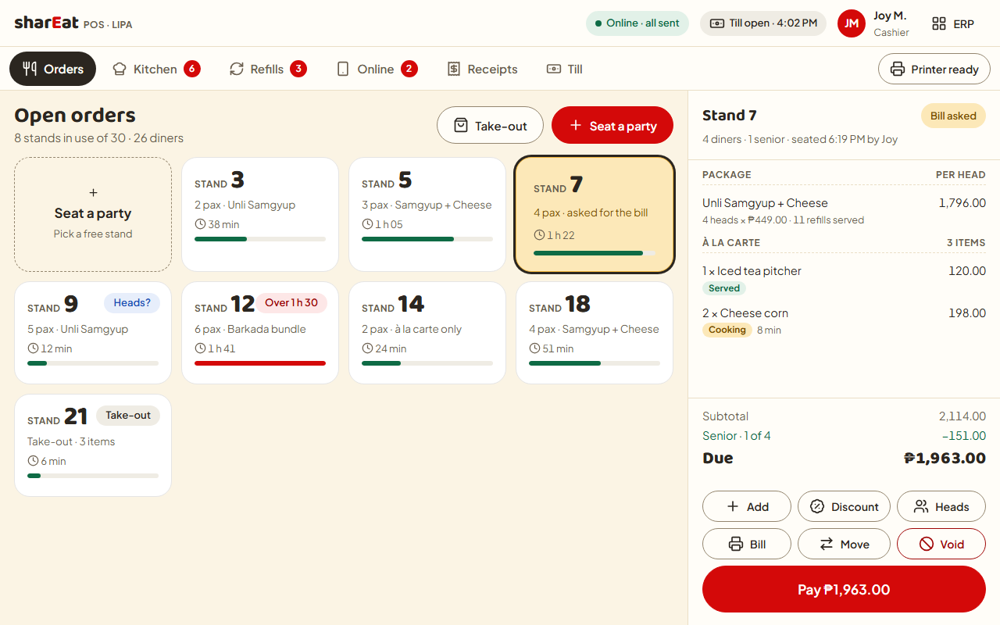
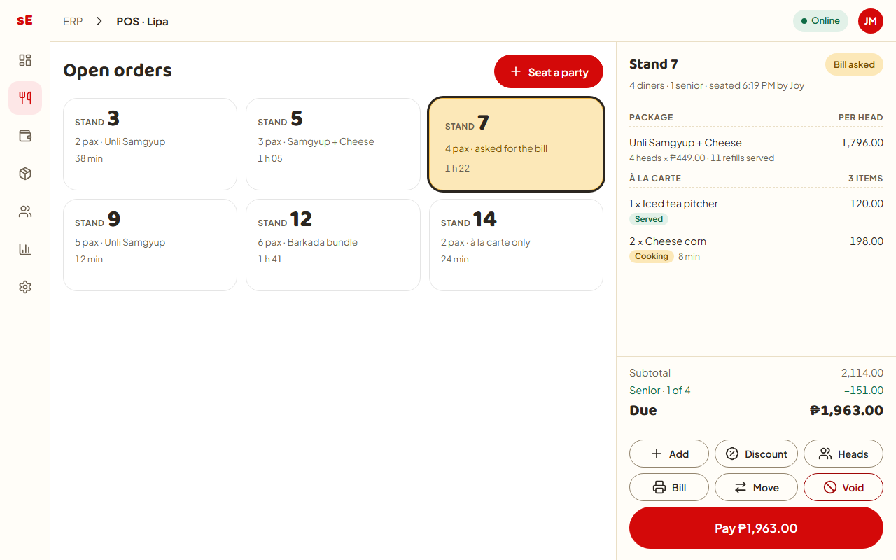
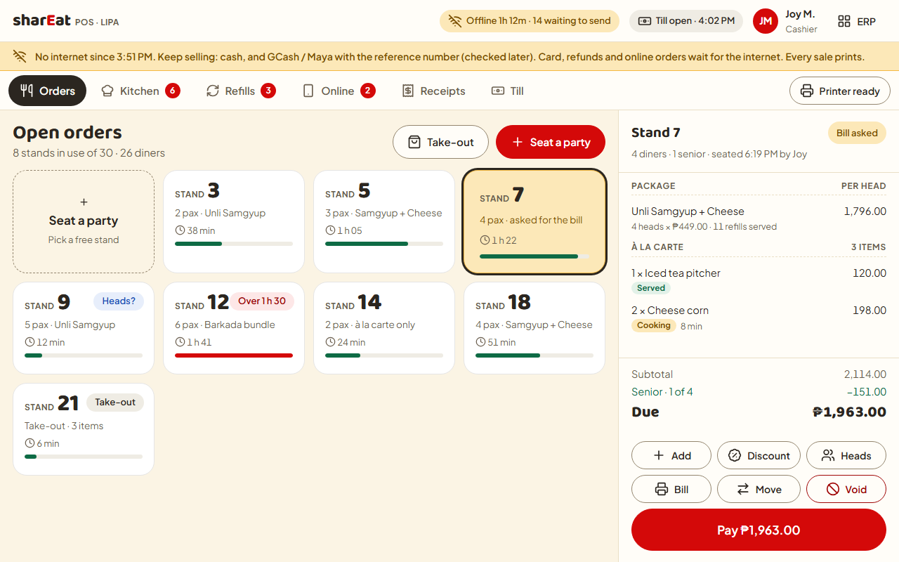
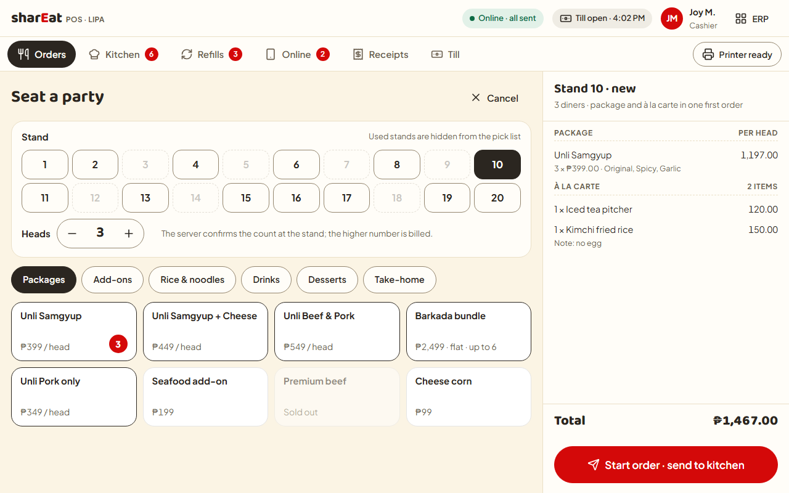
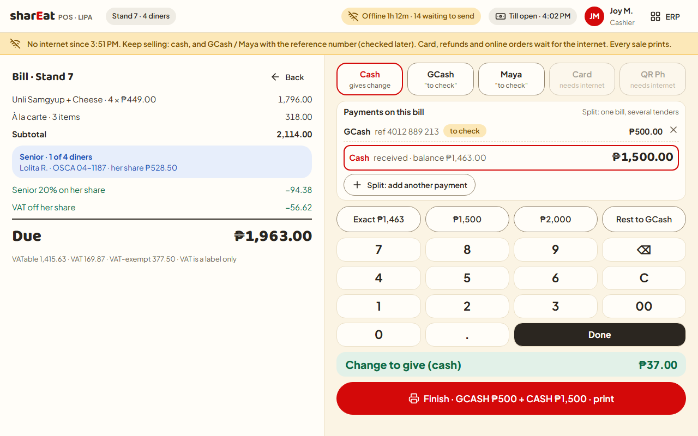
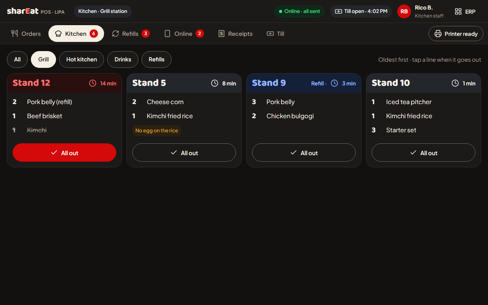
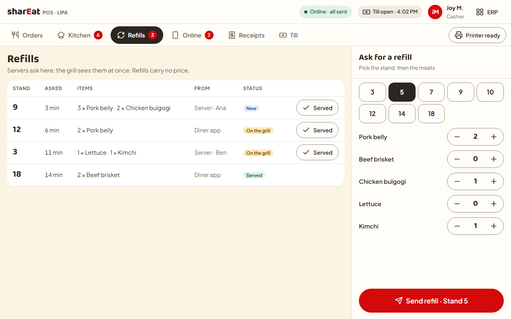
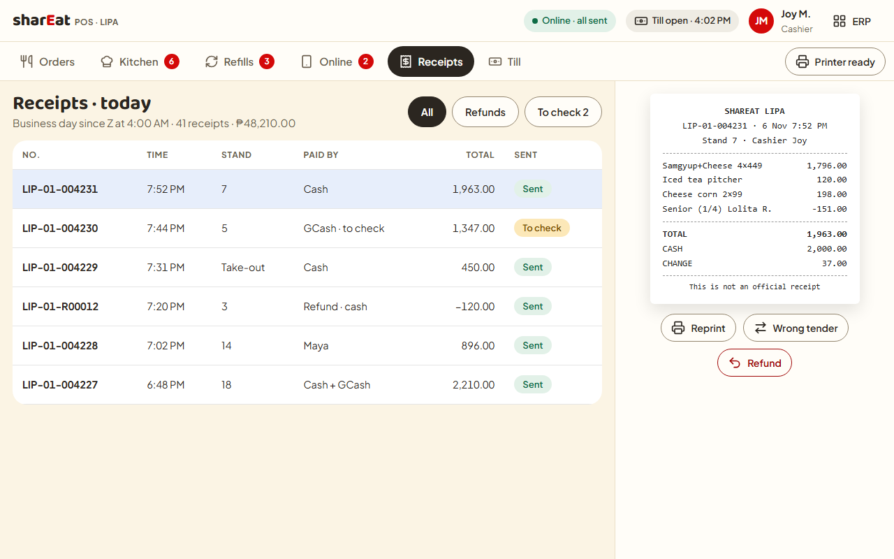
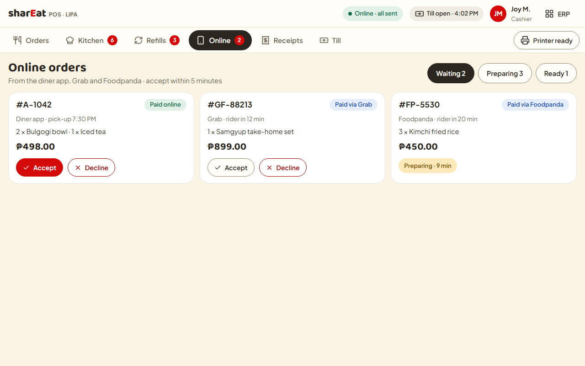

# POS v2 design: the POS as a piece of the ERP, with no Firebase database

| | |
|---|---|
| **Status** | ✅ **APPROVED by Ian, 2026-11-06** (answers in §11; bible rows 430–434). Lipa goes live on it **Mon 7 Dec 2026**, gated on the 24 h soak (§9). Each slice still gets its own spec, written in plan mode, before code. |
| **Asked by** | Ian, 2026-11-06: *"lets pivot design the POS now that its backend is the same as erp like pos is a piece of erp"* and *"no firebase db now"* |
| **Method** | `/research-evaluate-propose` (bible row 283) and `/impeccable` (standing rule, 3 Nov). The mocks were rendered and the choices made from the screenshots |
| **Builds on** | ADR-015 and its 15 Oct amendment · bible rows 269–283, 307, 313, 319, 348, 351, 356–359, 371, 378–383, 390–393, 408 · T-422/423/424/425, T-462/463/464, T-505, T-508, T-510, T-518 · discovery 39 (v1 study), 42 (usage counts) |
| **Amends** | The bible, applied on Ian's Q1 yes (rows 430–434, §6). ADR-015 Amendment 2 (6 Nov) records A1.1, A1.6 and A2's POS timing as superseded, and A8 as closed |
| **Mocks** | `docs/plans/pos-v2-design/*.png` (1280×800, the tablet's landscape size), source `docs/plans/pos-v2-design/mocks.html` |

---

## 0. For Ian, in plain words

- **The POS becomes a set of screens inside the ERP app** (the website at erp2.shareat.net, opened on the store tablet). It uses the same database, the same sign-in and the same staff PINs. There is no separate POS server and no Firebase.
- **When the store's internet drops, the tablet keeps selling.** It saves each sale on the tablet and sends it when the internet comes back. That works for 24 hours, the same promise you set on 4 Oct (row 276). Cash and GCash/Maya with a reference number keep working, and every sale prints. Card payments, refunds and online orders wait for the internet.
- **The screens keep what you already approved** (stand numbers, package and à la carte on one first order, the payment screen). They are redrawn in the ERP's red-and-cream look and made for fingers.
- **Your answers (6 Nov):** Lipa goes live on the new POS on **Monday 7 December**. To make that date we cut what the first release does, not the testing: the 24-hour test on two tablets still has to pass first, and it must start by **Wednesday 2 December**. Refunds, Convert, wrong-tender fixes, senior/PWD per diner, online orders and loyalty come after go-live (§9).
- **What Lipa staff will miss for the first weeks:** Convert (GCash cash-in/out, about 3 a day at Lipa) and refunds after payment (7 ever). §9 recommends pulling Convert in before go-live if the lanes keep pace.

---

## 1. Verdict

**Build it: POS v2 as a full-screen mode inside `apps/erp` (route `/pos`), on the one Postgres, with an on-device outbox for offline selling.** Retire `apps/pos`, the `pos2.shareat.net` service and every Firebase/`app.shareat.net` dependency of the POS, store by store.

This is a smaller change than it sounds:
- The ERP side already owns most of what the POS needs: menu and prices (row 383, T-508, T-510), kitchen stations (T-508), tenders (T-375), the till (row 319), tablet pairing and PIN sign-in (T-464), manager PIN approval (row 351), stock-usage drafts (rows 341–342), sales days (row 270).
- What is missing is the **live-floor data** (stands, orders, kitchen tickets, refills, receipts, refunds, Z readings) as Postgres tables, the screens, and the offline outbox.

---

## 2. The stated reason, and whether it holds

| Ian's reason | Holds? | Why |
|---|---|---|
| "its backend is the same as erp" | **Half.** | The backend is the same for menu, tenders, till, sign-in and manager PIN. It is **not** the same for the floor today. Every POS v2 floor screen still reads and writes Firestore `shareat-hub-v2`: about 97 files import Firebase, and sessions, receipts, kitchen tickets and Z readings live there. So the pivot is real work, not a re-label. |
| "pos is a piece of erp" | **Yes, and it pays.** | One app means one deploy, one sign-in, one set of capabilities, one design kit, and no second service on the 4 GB server (risk R6 in the phase plan). It also removes the POS's hidden dependence on v1's server (`app.shareat.net`: loyalty, PINs, PayMongo, online orders). |
| "no firebase db now" | **Yes. Already ruled.** | Row 280 (5 Oct) took the business completely off Firebase. ADR-015 A2 planned it in steps (sign-in P1, sales P2, tables P3), and row 378 then shipped P0 on Firebase for speed. "Now" collapses the steps: **no further POS release is built on Firebase.** The live trial at Lipa is a separate question (§11 Q2). |

---

## 3. What already exists

### 3.1 In this repo (reuse; do not rebuild)

| Piece | Where | Use in the new POS |
|---|---|---|
| Menu, prices, packages, refills, dayparts | `packages/domain/src/menu` (`loadMenuForTerminal`, `StoreMenuV2` + `contentHash`), migrations 0232/0233 | The tablet's menu snapshot, unchanged |
| Kitchen stations and routes | `kitchen_stations`, `kitchen_routes`, `packages/domain/src/kitchen` | Ticket routing to the Grill / Hot kitchen / Drinks tabs |
| Tablet pairing + Employee ID + PIN | `packages/auth/src/pos-tablet.ts`, `pos_tablet_pairings` (T-464, rows 381–382) | **The POS sign-in.** It is already in the ERP; it was never wired into `apps/pos` |
| Manager PIN approval | `verifyPosManagerApproval`, `approve_pos_correction` (row 351) | Refunds, wrong-tender corrections, voids |
| Till shifts | `till_custody_shifts`, T-186/T-153/T-143/T-366 (row 319) | The Till tab drives these rows directly |
| Tenders | `tenders` master (T-375) | Payment buttons, keyed by id, never by name |
| SC/PWD record | `statutory_discount_records` | Written at payment |
| Stock-usage drafts | rows 341–342, T-401 S6 | Fed from POS receipts instead of the v1 pull |
| Offline logic | `apps/pos/src/lib/terminal/db.ts`, `lib/outbox/*`, `lib/offline/*` (T-423/T-425) | **Ported, not copied blind.** The rules (one IndexedDB opener, per-terminal number series, offline refusals, X-slip, ₱50k banner, update gate) are good. The payload is not: its events are raw Firestore document writes and must become typed events (§5) |
| Bluetooth ESC/POS printer plugin | `apps/pos/android/.../ThermalPrinter` | Carried into the new APK shell |
| Kiosk-style page with no ERP shell | `apps/erp/src/proxy.ts` tags `/clock` as kiosk | The same mechanism makes `/pos` full-screen |
| Nightly receipt bridge | T-472, `pos_bridge_*` | Keeps reading **v1** stores until each switches; then that store leaves the bridge |

### 3.2 In v1 POS (requirements, read per §1.2d)

**Goal (written down, per §1.2d step 2):** sell a per-head unlimited package whose real head count is verified at the stand, let diners add à la carte, route food to kitchen stations, pace refills, take any tender with correct change, print paper every time, and never stop selling when the internet drops. Every action is tied to a person.

**Live data (discovery 42, 91 days to 16 Oct; §1.2d step 3):**

| Fact | Number | What it changes |
|---|---|---|
| Receipts, Lipa | 26.8 a day, peak 12 in an hour | Load is tiny. Polling every 3 s is fine; no live-push machinery is needed |
| Receipts, all four stores | ~64 a day, 5,180 in total | One Postgres is far more than enough (row 274) |
| Package dine-in share | 81.5% of sessions, ~3.1 guests | The stand + head count + package path is the core screen |
| Offline receipts | **0** in window, 1 ever | Outages are rare. Offline must be *safe*, not *rich*: keep it to the basics (row 276) |
| Online orders | **3 all-time** | The Online tab is built last (§9) |
| Payment conversions | 333 (Lipa 308) | "Convert" stays its own feature (row 359) |
| Edited paid receipts | 13 | Replaced by the wrong-tender correction (A4.2) |
| SC/PWD discounts | 0 recorded | Keep the per-diner design (PC-7), and ask Lipa staff how seniors are handled today |
| Menu size | 100–180 items, 11–15 packages, 7 flavours | The whole menu fits in one snapshot of a few hundred KB |

---

## 4. What the industry does, and open source

| Source | Pattern | Taken / not taken |
|---|---|---|
| [Toast offline mode](https://doc.toasttab.com/doc/platformguide/platformOfflineMode.html) | Each device switches to offline after about 40 s without a connection. It keeps taking orders, and blocks shift review, cash reconciliation, gift cards, loyalty and online ordering until it reconnects | **Taken:** the same split between what works offline and what waits (§5.4) |
| [Square offline payments](https://squareup.com/help/us/en/article/7777-process-card-payments-with-offline-mode) | Store-and-forward with a time window (24 h is commonly cited); loyalty is not supported offline | **Taken:** the 24 h window and no loyalty offline. **Not taken:** offline cards (we have no card processor that allows it; card stays refused, A3) |
| Odoo POS ([forum description](https://odoo.com/forum/help-1/whats-the-mechanism-of-pos-offline-283217)) | A browser single-page app preloads products and prices into IndexedDB and queues orders locally. You cannot *open* a new session offline | **Taken:** a menu snapshot in IndexedDB plus a local queue. **Improved:** Odoo's reported weak points are no idempotency and lost queues on refresh. We use `UNIQUE (device_id, seq)` on the server and an outbox that survives a reload |
| [PowerSync](https://powersync.com/) (Apache-2.0 client SDKs, self-hostable Open Edition) / ElectricSQL | A general Postgres ↔ device sync engine | **Not adopted.** It is a second always-on service on a 4 GB box, plus logical replication, to sync about 64 receipts a day. Our data flows one way (the till records facts; the server decides), so an outbox plus a snapshot does the job with no new moving part. Revisit only if two devices must bill one table offline (row 276's P3 condition), which row 313 rules out today |
| Dexie / idb (Apache-2.0 / ISC) | IndexedDB helpers | **Not needed.** `apps/pos/src/lib/terminal/db.ts` already wraps IndexedDB with tests. Keep it |
| `@capacitor-community/sqlite` | Native storage | **Held in reserve** (row 276): only if the soak shows IndexedDB losing data |

---

## 5. Architecture

### 5.1 The shape

```
 Store tablet (APK = Capacitor shell)              erp2.shareat.net (apps/erp, one Next app, port 9008 locally)
 ┌───────────────────────────────────┐            ┌──────────────────────────────────────────────────────┐
 │ /pos  (full-screen, no ERP shell) │  online    │ /pos pages (client components)                       │
 │  ├ local store (IndexedDB)        │──────────► │ /api/pos/events    POST  typed events → domain        │
 │  │   menu · stands · tenders ·    │            │ /api/pos/snapshot  GET   menu/stands/tenders/staff    │
 │  │   staff list, PIN verifiers*   │ ◄──────────│ /api/pos/state     GET   open stands, tickets (poll)  │
 │  ├ outbox (typed events, seq)     │            │        │                                              │
 │  ├ service worker (app shell)     │            │ packages/domain/src/pos  ← authorize() + RLS          │
 │  └ Bluetooth printer plugin       │            │        │                                              │
 └───────────────────────────────────┘            │      Postgres (the one database, row 274)             │
 Server phone / kitchen screen: a browser,        └──────────────────────────────────────────────────────┘
 signed in to the ERP, on /pos/refill or /pos/kitchen (online only)
```

### 5.2 Decisions, each with its reason

| # | Decision | Why / what it rules out |
|---|---|---|
| A1 | **The POS lives in `apps/erp` at `/pos`.** It is full-screen through the existing kiosk tag in `proxy.ts`, with tabs for Orders · Kitchen · Refills · Online · Receipts · Till | "A piece of the ERP". One deploy, one sign-in, one design kit. `apps/pos` and `shareat-pos.service` retire after the last store switches. The app-boundary rule (no app imports another) is kept, because nothing crosses apps |
| A2 | **The till screens are client components over a local store.** Every till action is written locally first, then sent (`commitLocalFirst`, T-425's rule). Online and offline run **one code path** | A Server Action cannot be queued offline (bible §5.2's binding rule still holds, only the carrier changes). One path means the offline path is exercised all day, not only during an outage |
| A3 | **Typed events, not document writes.** Kinds include `stand.opened`, `lines.added`, `heads.confirmed`, `refill.requested`, `ticket.served`, `sale.completed`, `session.voided`, `xslip.printed`. Each event carries `(device_id, seq)`, the person, the client time and raw facts only | Bible §5.1 Lane B rules. `UNIQUE (device_id, seq)` makes a replay silently harmless (§5.4 rule 4). The server **recomputes every bill from its lines and compares**; a mismatch becomes a finding (row 276, §5.4 rule-1 carve-out) |
| A4 | **The server is the only writer of truth.** `/api/pos/events` runs `authorize()` and the domain function in one transaction per event. Refunds, wrong-tender corrections and Z readings are **online-only requests**, not events | Row 351's server-side manager PIN rule, with no separate POS server. A failed event is **quarantined and shown** to the manager, never dropped (§5.4 rule 5) |
| A5 | **Sync to other devices is polling.** Each screen asks `/api/pos/state?since=<version>` every 3 s while online. The server keeps one version counter per store and answers 304 when nothing changed | Lipa peaks at 12 receipts an hour; three devices polling cost nothing. No WebSocket, no LISTEN/NOTIFY, no Firestore listener. SSE is added only on a measured need |
| A6 | **Snapshot with ETag.** Menu (with dayparts), stands, tenders, discounts, store POS settings, and the store's **active staff list** (ids, display names). *Corrected 6 Nov while specifying T-523: the server holds only one-way PIN hashes, so it cannot make per-tablet verifiers, and shipping its hashes would let a copied tablet guess a 6-digit PIN quickly. Instead a **device-only verifier** is made on the tablet when a person signs in online there (ADR-015 §5 O5), dropped when the person leaves the staff list* are fetched on sign-in and every 5 min. The tablet never blanks a good snapshot on a failed refresh (T-508's rule) | The device can sell and switch cashier offline (row 276's O5). Verifiers expire after 24 h offline, and a staffer who is revoked disappears at the next refresh |
| A7 | **Sign-in = T-464:** a paired tablet (httpOnly cookie, stored as a hash), then Employee ID (3-digit badge number) + PIN, with 5 wrong tries pausing that ID for 5 minutes. A person with two positions picks one, and the pick only narrows (row 323) | Already built and smoke-tested in the ERP. No Firebase Auth, no store email account |
| A8 | **The APK is a thin Capacitor shell** that opens `https://erp2.shareat.net/pos`. A service worker pre-caches the `/pos` app shell and its code so a **cold start with no internet** still opens the till. The Bluetooth printer plugin is native. New app id (A1.3 rule: never install over a store's roll-back app) | One build of the screens serves the tablet and any browser. Updates are a normal ERP deploy. The update gate blocks loading new code while the outbox is not empty (T-425). **Risk R1:** if the soak shows the service worker failing a cold start, fall back to bundling the same `/pos` client build inside the APK (Capacitor `webDir`). The cost is a second build target, with no change to the design |
| A9 | **One tablet per store bills** (row 313). Server phones and a kitchen screen are ordinary signed-in ERP browsers. They are **online-only**: Refills, Kitchen and the waiter's "add item" | Row 313 removes the two-tablets-one-table problem. If store Wi-Fi is down, phones are down too, and the kitchen gets printed tickets from the till (§5.4) |
| A10 | **New tables live in Postgres under `packages/db` and `packages/domain/src/pos`.** These are table sessions (named `table_sessions`, per GLOSSARY; keyed to a stand), session lines, kitchen tickets (as line states), refills (price-0 lines), receipts + lines + payments, refunds (a new receipt with `parent_receipt_id`, row 272), tender corrections, Z/X readings, the POS event inbox, and the stand master per store (row 371) | The column-level design is slice S1's spec (in plan mode), not this document (ADR-015 "does not decide"). Every new table is classified in `cutover/classification.ts` and `rls/registry.ts`; migrations are hand-authored from **0238** (ADR-012) |
| A11 | **Sales day source = `pos_receipts` per store** from the switch date (row 270's derived closing). The day feed and the bridge stop for that store. Stock-usage drafts come from receipts × depletion rules (rows 341–342) | One source of truth. No figure is typed in the ERP |

### 5.3 What this does **not** change

Receipt numbering `(store, terminal_no, seq)`, continuous and never reset (DEF-587) · paid receipts are immutable; mistakes are refunds or tender corrections (rows 272, A4.2) · one price per head (A4.3) · the till is an ERP record (row 319) · X/Z are cash-control slips, not BIR documents (row 390, A4.5) · cash refunds come off expected drawer cash (row 391) · the business day runs Z to Z (row 390).

### 5.4 Offline: what works and what does not

**Works offline (on the store tablet, up to 24 h):**

| Action | How |
|---|---|
| Seat a party on a free stand, set heads and package, add à la carte | From the snapshot. Head confirmation by a server waits; the cashier's count is used and reconciled later (`max(cashier, server)`, v1 rule) |
| Send to kitchen | The kitchen ticket **prints** on the Bluetooth printer (v1's outage backup print). The kitchen screen catches up on reconnect |
| Refill at the till | Prints a refill slip. Refills carry no price |
| Bill, discount (preset and SC/PWD from the snapshot), split tender | The device computes the bill to print it. The server recomputes and compares after sync |
| Take cash, and GCash/Maya **with the reference number**, marked "to check" | A3 ruling. Checked against the wallet after sync |
| Print the receipt; reprint | Every offline sale prints (row 276) |
| Switch cashier | Offline PIN verifier (A6), valid 24 h since the last online refresh |
| Void an **unpaid** stand | Manager/admin only, marked `voidedOffline`, reviewed after sync (row 356) |
| X-slip | Prints automatically every 4 offline hours (row 276) |
| See what is waiting to send | Top-bar pill ("Offline 1h 12m · 14 waiting to send"); manager warned at ₱50,000 unsent and selling continues (A3) |

**Refused offline, with a plain message:**

| Action | Message / reason |
|---|---|
| Card, QR Ph | "Card and QR Ph need the internet." (cannot be verified) |
| Refund, wrong-tender correction | "Refunds need the internet." (row 356; the manager PIN check runs on the server) |
| Z-reading / day close, till close | Needs the server's totals. The day stays open until the internet is back |
| Online orders, loyalty earn/redeem | Need the server; redeeming points offline could spend them twice |
| Kitchen and Refill screens on other devices | Online-only. The till prints instead |
| Opening the POS on a tablet that was **never** signed in online | Needs a first snapshot |

**Limits stated plainly:** the outbox survives app kill, reboot and update. It does **not** survive "clear data", uninstalling the app or a dead tablet. Paper is the backstop: a manager re-enters a lost tablet's unsent sales from the printed copies as a late, audited entry (ADR-015 §5).

### 5.5 Attendance clock terminals

**Out of scope here, and not affected by this design.** The clock still runs on Firestore (bible §5.3 items 1–6, the `/clock` kiosk). Row 280 already decided it moves to "the same on-device offline approach as POS". The sensible order is to build the POS outbox first and then move the clock onto it as **its own task** after the POS switch. **Consequence Ian should know:** the Firebase project cannot close (ADR-015 A2: 90 days after the last store) until the clock has moved too. File storage (`@shareat/storage-firebase`) is the same case.

---

## 6. Bible amendment — ✅ APPLIED on Ian's Q1 yes (rows 430–434, version 3.23)

The bible's "Postgres owns the truth; Firebase owns the edge" line (§1 line 203, CLAUDE.md "60-second version", §5's title) predates row 280. Row 280 already removed Firebase; the text was never brought in line. This design also changes ADR-015's step plan and row 378's Firebase P0. **Applied 2026-11-06 by the Opus planner (POS design lane) on Ian's Q1 = (a).** The row below went in as **row 430**, with rows 431–434 recording the other answers. `docs/RULES.md` rows 4–5 follow. ⚠️ **Not edited by this lane:** `CLAUDE.md` and `AGENTS.md` (the "60-second version" line). They are agent instruction files, so BOSS or Ian applies the one-line change shown in the table.

**The §13 row as proposed (applied as row 430; the applied text adds Ian's answers):**

> **POS v2 IS A FULL-SCREEN MODULE OF THE ERP APP (`/pos` in `apps/erp`), ON THE ONE POSTGRES, WITH THE ERP'S SIGN-IN (T-464 pairing + Employee ID + PIN) AND `authorize()`. NO FIREBASE DATABASE, AUTH OR SERVER FOR ANY NEW POS RELEASE. OFFLINE SELLING USES THE TABLET'S OWN OUTBOX (TYPED, APPEND-ONLY EVENTS KEYED `(device_id, seq)`) AND A VERSIONED SNAPSHOT; THE SERVER RECOMPUTES AND IS THE ONLY WRITER OF TRUTH.** Ian, 2026-11-06: *"pos is a piece of erp"*, *"no firebase db now"*. **Supersedes:** ADR-015 A2's step timing for the POS (P1–P3 collapse into one switch per store); A1.6's separate POS server service; row 378's "P0 ships on v1's Firebase" for any release after the Lipa trial; row 275's "carrier is Firestore during P0–P1". **Keeps:** rows 270, 272, 276, 313, 319, 351, 356, 371, 390, 391 and the §5.1 Lane A/B **rules**. Row 379's bridge keeps running for stores still on v1 until each switches. **Clock terminals unchanged** until their own task (row 280's direction stands). Design: `docs/plans/pos-v2-design.md`.

**Text edits that go with the row:**

| Where | Today | Proposed |
|---|---|---|
| §1 line 203, CLAUDE.md, AGENTS.md "60-second version" | "Postgres owns the truth; Firebase owns the edge." | "**Postgres owns the truth. A device keeps only a short offline queue and a snapshot.** (The clock terminal still uses Firestore until its move, row 280.)" |
| §2 rule 4 | "Firestore is one-way except the inbox lane." | "**Device storage is one-way except the outbox.** A snapshot is read-only to the device; an outbox event is append-only and never read as truth. (Firestore, while the clock still uses it, follows the same rule.)" |
| §5 title and §5.1 intro | "the Firebase hot lane"; "Every Firestore document…" | "**the edge lane**"; "Every piece of device-held data is one of two kinds", with Lane A = snapshot (server-written, versioned, tombstones) and Lane B = outbox (append-only, idempotent, raw facts, quarantine never drop). Carrier: device IndexedDB + `/api/pos/*` for POS; Firestore for the clock until it moves |
| §5.2 "binding consequence" | "the clock terminal reads and writes Firestore via the client SDK, never via Server Actions" | Add: "**The POS till writes to its outbox and sends via `/api/pos/events`, never via Server Actions on the offline path.**" |
| §5.3 hot set | POS entries "added at P1 per ADR-015", carrier provisional | The POS snapshot is a **closed list**: menu + dayparts, stands, tenders, discounts, store POS settings, active staff list; PIN verifiers are made on the device at online sign-in (24 h expiry). No financial history, no other store's data, no personal data beyond a display name |
| `docs/RULES.md` rows 4–5 | Firestore wording | Follow the bible |

---

## 7. Screens (rendered; decided from the screenshots)

**Look:** the ERP's own kit (ADR-013, T-387, T-448): warm cream canvas, red only for the one main action, Plus Jakarta Sans text, Baloo 2 headings and numbers, round buttons, 20 px cards, the Grill Night dark theme where the light is harsh. **Touch:** targets of at least 48 px (60 px for Pay and Send), no typing except notes and amounts (row 371), and a person never has to scroll to find the main button.

**Layout decision (from the two renders below):** **full-screen POS mode wins over a POS page inside the ERP sidebar shell.** At the same size the full-screen mode shows 9 stands against 6. It puts the station tabs with live counts (Kitchen 6, Refills 3) where a cashier sees them, and keeps the till, online and printer status on screen. The ERP rail's icons mean nothing to a cashier. Managers still reach the ERP in one tap (the "ERP" button, top right) with the same sign-in.

| Full-screen POS mode ✅ chosen | Inside the ERP shell ✗ |
|---|---|
|  |  |

### 7.1 Screen map

| Tab | Who | Device | Online / offline | Mock |
|---|---|---|---|---|
| **Orders** (open orders by stand) | Cashier | Store tablet | Both | `orders.png`, `orders-offline.png` |
| ↳ Seat a party / add items | Cashier (and a server on a phone, online) | Tablet / phone | Both on the tablet | `new-order.png` |
| ↳ Payment | Cashier | Tablet | Both (cash, GCash/Maya "to check" offline) | `payment.png`, `payment-offline.png` |
| **Kitchen** (tickets by station, oldest first) | Kitchen staff | A kitchen tablet or TV browser | Online; prints offline | `kitchen-dark.png` (Grill Night), `kitchen.png` |
| **Refills** (queue + ask) | Servers, grill | Phone / tablet | Online; till prints offline | `refill.png` |
| **Online** (diner-app orders; Grab/Foodpanda later) | Cashier | Tablet | Online only | `online.png` |
| **Receipts** (today, refund, wrong tender, reprint) | Cashier, manager PIN | Tablet | Reprint offline; refund online only | `receipts.png` |
| **Till** (open, count, handover, X, Z) | Cashier, manager | Tablet | X offline; Z online | (unchanged ERP till rows, row 319; no new mock) |

### 7.2 The renders

**Orders — open stands, bill on the right.** Every open stand is a tile: number, heads, package, time seated, a time bar that turns red past 1 h 30, and a "Heads?" or "Bill asked" tag. Tapping a tile opens its bill. Pay is the one red button.


**The same screen offline.** A yellow band says what still works; the top pill counts what is waiting to send.


**Seat a party.** Stands are tapped, never typed, and used stands are greyed out (row 371). Heads use a stepper. The first order can hold a package and à la carte together (row 358). Sold-out items show but cannot be tapped (row 307's sold-out flag).


**Payment, as approved in PC-7, redrawn, with split payment (row 438).** The whole bill stays on the left. On the right, "Payments on this bill" lists each tender: here GCash ₱500 with its reference, then Cash ₱1,500 being entered, with the balance shown. "Split: add another payment" adds the next tender with the rest pre-filled, as v1 does. Change comes only from cash. Offline, Card and QR Ph grey out and GCash/Maya say "to check".


**Kitchen, Grill Night theme.** One card per stand, oldest first, a station filter, and late tickets in red. "All out" is the tap. Dark because kitchens are hot, bright and read from a distance; the light version is also rendered (`kitchen.png`).


**Refills.** On the left is the queue, showing who asked (a server or the diner app) and its status. On the right, pick a stand, step the meats and send. There are no prices.


**Receipts.** Today's receipts since the last Z, with a "To check" filter for offline e-wallet payments. Tapping a row shows the paper copy with Reprint, Wrong tender and Refund (both of the last need a manager PIN and the internet).


**Online orders.** Built last (3 orders all-time). Only the oldest order gets the red Accept. Grab/Foodpanda cards show where row 271 is headed ("include to pos soon"); today those stay a separate ERP entry.


**Not mocked, on purpose:** the Till tab (it is the ERP's existing till screen, row 319), sign-in (T-464's screen exists), and Convert (a dialog, T-427 rules unchanged).

---

## 8. Moving a store off v1 / the Firebase trial (the switch-over)

A store switches **at a business-day boundary, never mid-day**. No open stand crosses systems.

**Default (orchestrator, 6 Nov; Ian told):** everything switches at once (sign-in, sales and tables together), not in ADR-015 A2's three steps. Step by step would run a store half on Firebase and half on Postgres for weeks (§15.4). Recorded in ADR-015 Amendment 2 and row 430.

| When | Step | Who |
|---|---|---|
| A week before | Menu, packages, refills, flavours, stands, tenders, discounts and kitchen routes checked in the ERP (they are ERP-owned already, row 383). Staff have badge codes and ERP PINs | Manager + orchestrator |
| A day before | Manager pairs the tablet (`pair_pos_tablet`) and installs the new APK **beside** the old app (new app id). A test sale is made on a TEST stand and refunded | Manager |
| Closing night | Old app: every stand closed, the outbox empty, the final Z printed | Cashier |
| Opening morning | The ERP sets the store's sales-day source to `pos_receipts` from today's business date (as row 284 did for the feed link). The store leaves the nightly bridge from today. Cashiers sign in with Employee ID + PIN | Admin (one ERP action, audited) |
| First week | Daily check: the receipt count and totals against the till count; the quarantine list is empty | Orchestrator |
| Roll-back (if needed) | Next morning only: the old app is reopened and the source flips back from that date. A business day never mixes two sources | Admin |
| 90 days after the last store (and the clock) | Firebase project closed (ADR-015 A2) | Ian |

Nothing historical moves: pre-2027 POS data is test data (row 379). Loyalty balances (129 members) move when loyalty is built (§10).

---

### 8a. ✅ RULED (a) — Lipa's December sales and the 2026 books (Ian, 6 Nov; row 436)

**The hole.** The 2026 books close on v1 (row 379, ADR-005). v1's ERP gets a store's sales by an HTTP pull,
`GET {POS_API_URL}/api/external/sales?storeId&date` (`ERP-rebuild/src/lib/server/pos-api.ts:143-168`). POS v1 answers
from **one Firestore document per day**, `stores/{posStoreId}/analytics/{yyyymmdd}`
(`POS/src/app/api/external/sales/route.ts:21-35`). It reads **day totals only**: `payments.totalGross`,
`payments.txCount`, `payments.byMethod` (amount per method name; must sum to the gross within ₱1), `payments.discountsTotal`,
`payments.chargesTotal`, and optionally `payments.voidCashRetainedTotal`. Stock usage is a second pull,
`/api/external/sold-items`, which reads the **receipt** documents. From 7 Dec the new POS writes neither, so v1's pull
returns `found:false`. The form then silently stays typeable (`SalesReportForm.tsx:569, 697-717`), and December
sales reach v1 only if someone types them.

| Option | What happens | Effort | Risk |
|---|---|---|---|
| **(a) Day-total bridge to v1, until 31 Dec** | After each Z, the ERP server writes Lipa's day totals into that one Firestore document, in v1's field names (a full overwrite per day, never increments). v1's pull then works unchanged. Stock usage for December is entered by hand in v1 (the sold-items pull needs receipt documents, which are out of scope). Switched off on 1 Jan | **S, about 2 days**, inside T-531. Uses the write key the POS v2 server already has on the droplet (`POS_FIREBASE_SA_KEY_FILE`) and `firebase-admin`, which `apps/erp` already depends on | Needs Ian's exception to row 430's "no Firebase": a write-only, one-document-a-day, 25-day bridge. Method names must match v1's names (checked against v1's payment-methods route before go-live) |
| **(b) The manager types December day totals into v1** | Each morning the manager copies the printed Z slip into v1's sales form, and enters usage by hand | **None to build.** About 25 days × 5–10 minutes | Typing errors in the 2026 books, the problem row 270 was written to remove. v1's own check (₱1 tender sum) still catches some |
| **(c) Lipa goes live after 1 Jan** (Mon 11 Jan, the planned fallback) | December stays on the trial app, which still writes v1's format | **None.** Frees the 21 Dec – 10 Jan freeze for testing and gives 5 more weeks, which could pull refunds and Convert into the first release | Gives up Ian's 7 Dec choice (row 431). The purge question disappears: POS rows in Postgres would start in 2027 and are kept |

**Ian chose (a), 6 Nov (row 436);** December stock usage is typed into v1; pre-2027 POS rows in Postgres are purged. **The recommendation was (a).** Ian chose 7 Dec knowing the cost. (a) keeps that date and keeps the 2026 books
machine-fed, for two days of work, and the bridge dies on 31 Dec. Then the cutover class question answers itself: v1
holds December's day totals, so purging the December rows in Postgres loses no booked figure (row 379 stands). If Ian
will not allow any Firebase write, choose **(c)**, not (b): typed figures in a closing year are worse than a later go-live.

**Guards if (a) is chosen:** (1) the v2 06:00 import (T-396) must skip Lipa from its switch date, because Lipa's v2
sales day comes from `pos_receipts`, so the bridge doc is never imported twice; (2) the trial app must be signed out at
the switch, so it cannot add increments to the same document; (3) the writer refuses any date after 2026-12-31.

## 9. Slices, re-planned for Lipa on Mon 7 Dec 2026 (rows 431, 432)

**The rule (BOSS's ruling inside Ian's "rush"):** cut scope, not proof. The 24-hour two-tablet soak (0 lost, 0 doubled) is the go-live gate and runs before 7 Dec.

**Key dates**

| Date | Gate |
|---|---|
| Thu 12 Nov | Schema migration merged on its own PR (migration rule), applied to production behind the switch |
| Fri 20 Nov | End-to-end online on the emulator: seat → order → kitchen → refill → pay cash → print → ERP sales day |
| Wed 25 Nov | Offline path complete; APK installs on a real Lipa tablet with the printer |
| **Sat 28 Nov** | **Soak #1 starts** (24 h, two tablets, ~150 sales and ~2k events offline, then reconnect) |
| **Wed 2 Dec** | ⛔ **Latest soak start.** A soak starting later cannot finish, be fixed and be re-run before go/no-go |
| Fri 4 Dec 18:00 | Go/no-go (BOSS + Ian). Staff training on the soak build runs Thu 3 – Sat 5 Dec |
| **Mon 7 Dec** | **Lipa opens on the new POS** (§8 switch at the business-day boundary). Fallback: Mon 14 Dec, then after the freeze (from 11 Jan) |

**The first Lipa release (must ship by 7 Dec)**

| Task | Slice | Week | Size | Model | Depends on |
|---|---|---|---|---|---|
| **T-522** | Docs: bible rows 430–434 and ADR-015 Amendment 2 (**done 6 Nov**); this plan kept true | 6 Nov | S | Opus | — |
| **T-523** | Schema: stands master, `table_sessions`, session lines with kitchen states and price-0 refills, receipts + lines + payments, day-close (Z) record, POS event inbox `UNIQUE (device_id, seq)`, the per-store POS switch. Classification + RLS registry. Migrations from 0238. **Own PR** | W1 · 9–12 Nov | M | Opus spec (plan mode) → Sonnet | T-522 |
| **T-524** | Domain `packages/domain/src/pos`: open stand, add lines (package + à la carte), confirm heads (`max(cashier, server)`), refill, ticket served, void unpaid stand (manager/admin), pay with server recompute-and-compare (cash, e-wallet "to check", senior/PWD per diner writing `statutory_discount_records` with `source = pos`). Integration tests on real Postgres, including two voids at once and a replayed event | W1–W2 · 10–18 Nov | L | Sonnet (money lane) + Sonnet auditor | T-523 |
| **T-525** | APIs: `/api/pos/events` (idempotent, quarantine, mismatch finding), `/api/pos/snapshot` (ETag, closed list per §5.3 / row 430), `/api/pos/state` (version, 304) | W2 · 16–19 Nov | M | Sonnet | T-524 |
| **T-526** | `/pos` kiosk shell in `apps/erp`: tabs, status pills, T-464 sign-in wired, offline PIN verifier, route capabilities, census guards, Grill Night default on Kitchen (row 433) | W2 · 16–20 Nov | M | Sonnet | T-525 (stubs from 16 Nov) |
| **T-527** | Screens: Orders (stands) + Seat a party + add items | W2–W3 · 18–24 Nov | M | Sonnet | T-526 |
| **T-528** | Screens: Payment (**split payment: several tenders on one bill, row 438**; cash, GCash/Maya "to check", **senior/PWD per diner with name and ID**; share = own head + dishes ordered only for them, row 437) + receipt print and reprint (Bluetooth plugin, browser fallback) | W3 · 23–26 Nov | M | Sonnet (money lane) | T-527 |
| **T-529** | Screens: Kitchen + Refills (polling, T-508 station routing, printed tickets offline) | W3 · 23–26 Nov | M | Sonnet | T-526 |
| **T-530** | Offline: port `lib/terminal` + outbox to typed events, service-worker app-shell cache, offline printing, X-slip every 4 h, ₱50k warning, update gate | W2–W3 · 16–26 Nov | L | Sonnet | T-525 |
| **T-531** | Day close: Z on the POS (row 390) → ERP sales day `source = pos_receipts` for the store; Lipa leaves the bridge and the v1 day feed from the switch date. **Plus the December day-total writer to v1's Firestore document, up to 31 Dec only, with its three guards (row 436)**. Till opening and counting use the **existing ERP till screen** (row 319), no new tab | W3 · 23–27 Nov | M | Sonnet (money lane) | T-524 |
| **T-532** | APK shell (new app id, printer plugin, `server.url` + service worker) + CI job + emulator run (T-463 harness, no Firebase) + real Lipa tablet and printer check | W3 · 24–27 Nov | M | Sonnet + orchestrator | T-530 |
| **T-533** | Soak #1 (Sat 28 Nov) and fixes, soak #2 if needed (latest start Wed 2 Dec), Lipa switch runbook, staff training sheet, go/no-go pack | W4 · 28 Nov – 4 Dec | M | Orchestrator + Sonnet | T-527 to T-532 |

**After go-live (in this order)**

| Task | Slice | When | Size |
|---|---|---|---|
| **T-534** | Money follow-ups: **Convert** (row 359), wrong-tender correction (A4.2), refund online with manager PIN (rows 351, 356). ⭐ **Recommend pulling Convert into W3 if T-528 lands on time:** Lipa does about 3 conversions a day (308 in 91 days), so its absence is felt on day one. Refunds after payment are rare (7 ever); until T-534 a mistake is handled by voiding before payment | from 8 Dec (Convert possibly W3) | M |
| **T-535** | Preset (non-statutory) discounts (2 uses in 91 days across all stores, 0 at Lipa), stock-usage drafts from receipts (rows 341–342; until then Lipa's usage is entered by hand as row 282 Q-D allows), Online tab (3 orders ever), a waiter's add-item on a phone | Dec – Jan, after the freeze | L |
| — | Loyalty (row 432), the extras of A4.6, Malvar/Davao/Padre Garcia switches (from 11 Jan, one a week), the clock's move off Firestore (§5.5) | 2027 | — |

**Lanes.** One lane cannot do W2–W3 alone. The plan needs **three Sonnet builder lanes in parallel**, each with its own test database (§3.4: no shared state):
- **Backend:** T-523, T-524, T-525, T-531.
- **Screens:** T-526 to T-529.
- **Device:** T-530, T-532.

**Resolved with BOSS and Ian (6 Nov):**
1. **Merging 20 Nov – 14 Dec is allowed** while the new POS stays off for every store behind the per-store switch (row 435, narrows row 386).
2. **Three parallel Sonnet builder lanes** in W2–W3, each in its own worktree with its own `_test` database and no shared files (row 435).
3. **Convert (T-534) moves into W3 only if T-528 lands on time**; otherwise it follows go-live.
4. **The T-523 schema spec is due Mon 9 Nov** (Opus), migration **0238** (0237 = T-511 S5c).

## 10. Deliberately OUT (each with its reason)

| Out | Why |
|---|---|
| New features in `apps/pos` (the Firebase copy) | "No firebase db now". Only fixes the Lipa trial needs while it runs (§11 Q2) |
| Customer v2 app, diner push | P3 and row 280 (no push). The lobby (T-455) is already on Postgres and unaffected |
| Loyalty earn/redeem in the first release | 129 members. It needs a `diner` principal and an inter-org liability (row 273). It is a later slice (§11 Q4) |
| Reservations, chat, birthday song, games, flash ads, forecasts, weather | "Keep all extras" (A4.6) stands. Usage counts set the order, after the first switch |
| Grab/Foodpanda on the till | Row 271 (b): a separate ERP entry for now; v1 data shows they are not rung on the till |
| More than one billing tablet per store; a LAN hub | Row 313. Revisit only if that rule changes |
| Offline card, offline refunds | No processor support; row 356 |
| BIR accreditation | A4.5: keep today's set-up; numbering already fits a later registration |
| SQLite | Measure IndexedDB in the soak first (row 276, T-462) |
| Live push (SSE/WebSocket), a sync engine (PowerSync/Electric) | Polling covers 12 receipts an hour; a sync engine is a second service for no gain (§4) |
| Moving the clock terminal off Firestore | Its own task after S8 (§5.5) |
| A floor map | There are no fixed tables, only stands (rows 357, 371) |

---

## 11. Ian's answers (6 Nov 2026)

| Q | Question | Answer | Recorded |
|---|---|---|---|
| Q1 | Apply the rule change in §6? | **(a) Yes** | Row 430 + text edits (§6) |
| Q2 | What does Lipa do until the new POS is ready? | **(c) Rush: Lipa on the new POS by 7 Dec**, chosen against the recommendation after reading the warning. BOSS's ruling: the soak stays the gate; cut scope, not proof | Row 431, §9 |
| Q3 | POS inside the ERP app, or separate? | **(a) Inside the ERP** | Row 430 |
| Q4 | Loyalty in the first release? | **(a) No** | Row 432 |
| Q5 | Kitchen dark, till light? | **Not answered.** The recommended (a) is the **default, changeable per device** | Row 433 |

Also closed: ADR-015 A8's four open questions were already answered by later rows (row 434).

**Still open, for BOSS to take to Ian:** row 386's merge pause vs this plan (§9), and whether Convert moves into the first release (T-534).

---

## 12. Risks

| # | Risk | Plan |
|---|---|---|
| R1 | The service worker fails a cold start offline inside the Capacitor WebView | Soak test includes "kill the app and reboot the tablet while offline". Fallback: bundle the `/pos` client build in the APK (A8) |
| R2 | ERP deploys reach the till during service | Update gate: new code loads only when the outbox is empty and no payment screen is open (T-425) |
| R3 | The ERP is down while the store is online | The till treats a server error like offline (the outbox holds). It is the same path, so it is already tested |
| R4 | A priced line from a phone reaches a stand the till already billed offline | The server records it as an "after-bill line" finding for the manager. Rare (phones are offline too when the Wi-Fi drops) |
| R5 | The Lipa trial on Firebase runs longer than planned | Bridge (T-472) already copies its receipts; fixes only (Q2) |
| R7 | The soak fails twice before 4 Dec | Go-live moves to Mon 14 Dec, then to after the freeze (from 11 Jan). Lipa stays on the trial app meanwhile (row 431) |
| R6 | Firebase cannot close while the clock still uses it | Stated in §5.5; the clock move is queued after S8 |

---

*Not done in this pass:* no scratch-DB or live-route mocks (static renders of the ERP tokens were enough to decide layout); v1 discovery reused discovery 39/42 rather than a fresh full read (the fresh read stalled); no column-level schema (S1's spec).
