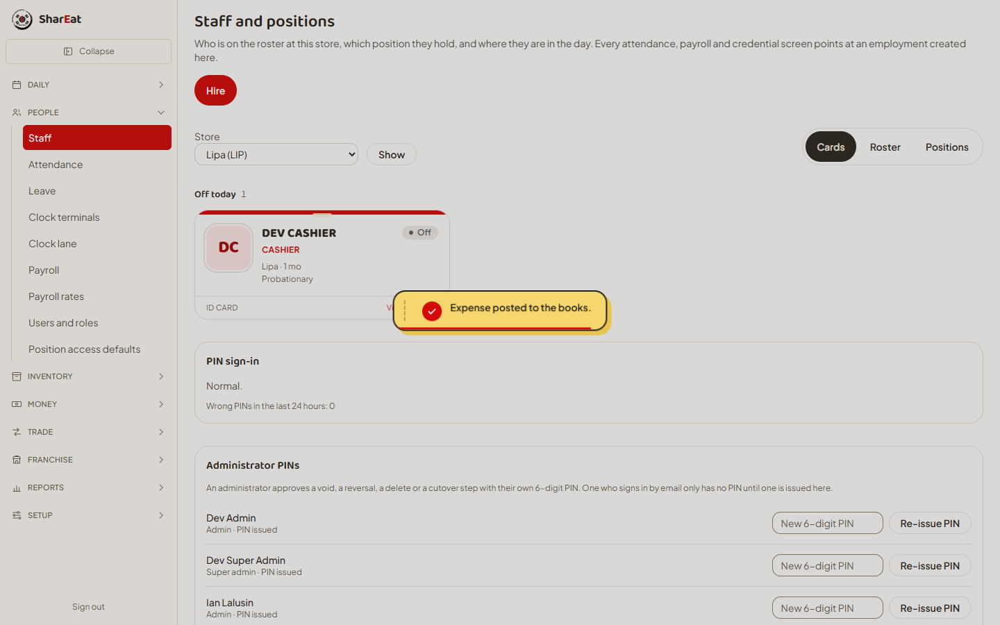
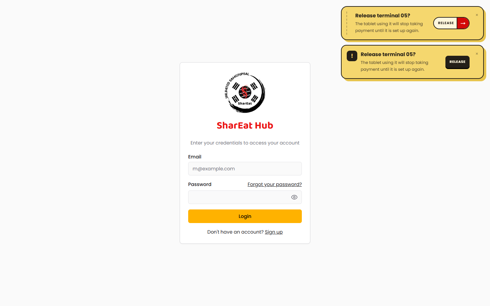

# T-568 S4 — Ticket and Keycap toasts

Ian picked **02 Ticket** for ordinary toasts and **01 Keycap** for destructive ones.

## Shipped

### Ticket — ordinary

- Flat `#F5D76E` panel, 2 px ink border, 18 px radius, hard `6px 6px 0 #E7C44E` shadow.
- A dashed ticket stub runs down the left edge.
- The action is a real split pill: cream label on the left, red arrow cell on the right.
- ERP success toast adds a red check stamp and a 4-second red progress line.
- POS default toasts use the same panel; the action keeps the split-pill treatment.

### Keycap — destructive

- Same flat yellow panel, 16 px radius, hard `7px 7px 0 #E7C44E` shadow.
- A black exclamation square marks the consequence.
- The action is a black keycap with a 3 px lip; it presses down on click.
- Used by the POS release-terminal confirmation and all `variant: "destructive"` toasts.

## Where

| App | Surface | File |
|---|---|---|
| ERP | Flash success toast | `apps/erp/src/components/feedback/Toaster.tsx` |
| ERP | Tokens and progress line | `apps/erp/src/app/globals.css` |
| POS | Toast panel, action, close | `apps/pos/src/components/ui/toast.tsx` |
| POS | Ticket / Keycap surfaces | `apps/pos/src/app/globals.css` |
| POS | Release-terminal confirmation | `apps/pos/src/components/settings/TerminalSection.tsx` |

## Colour

| Role | Value |
|---|---|
| Flat brand yellow | `#F5D76E` |
| Hard shadow edge | `#E7C44E` |
| Ink | `#241F18` |
| Cream action | `#FFF7DD` |
| Brand red | `#D40909` |

## Verification

- `npm run typecheck` — clean.
- `npm run build` — clean.
- `npm run build -w @shareat/pos` — clean.
- ERP toast tests green.
- Computed styles in both running apps: yellow `rgb(245, 215, 110)`, ink border
  `rgb(36, 31, 24)`, hard shadow `rgb(231, 196, 78) 6px 6px 0px`, Ticket stub
  `dashed`, Keycap mark `"!"`.
